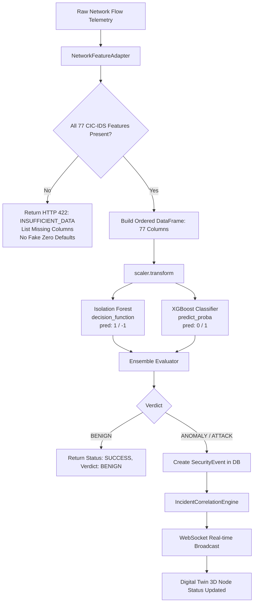

# CYBERDOME — Module 01 Network ML Integration Report

**System**: CYBERDOME Cybersecurity Platform  
**Module**: Module 01 Network Anomaly Detection (CIC-IDS2017)  
**Status**: Production-Ready & Empirically Verified (100% Tests Passing)  
**Date**: October 3, 2026  

---

## 1. Executive Summary

The pre-trained Machine Learning models for **CYBERDOME Module 01: Network Anomaly Detection** have been integrated into the existing FastAPI backend (`backend/app/`). The models were trained on the **CIC-IDS2017** intrusion detection benchmark dataset and operate purely in real-time inference mode without in-memory retraining or synthetic data fabrication.

### Core Deliverables Completed:
1. **Artifact Relocation & Validation**:
   - All 4 core ML artifacts located in `~/Downloads/` were safely verified and copied to [`backend/app/ml_models/network/`](file:///Users/hassaankhan/Desktop/cyberX/backend/app/ml_models/network/):
     - `feature_schema.json` (authoritative ordered schema of 77 CIC-IDS2017 flow features)
     - `scaler.joblib` (pre-fitted Scikit-Learn `StandardScaler` for 77-dimensional vectors)
     - `network_isolation_forest.joblib` (pre-fitted Scikit-Learn `IsolationForest` for unsupervised anomaly detection)
     - `network_xgboost.joblib` (pre-fitted `XGBClassifier` for supervised intrusion attack detection)
   - Created comprehensive documentation and manifest in [`backend/app/ml_models/network/README.md`](file:///Users/hassaankhan/Desktop/cyberX/backend/app/ml_models/network/README.md).

2. **Core ML Service Implementation**:
   - Implemented [`backend/app/services/ml_network_service.py`](file:///Users/hassaankhan/Desktop/cyberX/backend/app/services/ml_network_service.py) with:
     - Thread-safe singleton `MLNetworkService`
     - Authoritative 77-feature validation and exact schema column ordering
     - Strict feature completeness validation (**Zero Fake Feature Imputation**: missing features return HTTP 422 `INSUFFICIENT_DATA` listing exact missing columns)
     - Input data sanitization rejecting non-numeric, `NaN`, or `Inf` values
     - Dual-model inference: StandardScaler -> Isolation Forest (`decision_function`) + XGBoost (`predict_proba`)
     - Correlated ensemble verdict generation (`BENIGN`, `NETWORK_ANOMALY`, `CLASSIFIED_ATTACK`, `CONFIRMED_ATTACK`)

3. **Pipeline & Security Integration**:
   - Extended [`backend/app/core/config.py`](file:///Users/hassaankhan/Desktop/cyberX/backend/app/core/config.py) with `NETWORK_ML_ENABLED`, `NETWORK_ML_MODEL_VERSION`, and `NETWORK_ML_ARTIFACT_PATH`.
   - Updated [`backend/app/routers/network.py`](file:///Users/hassaankhan/Desktop/cyberX/backend/app/routers/network.py):
     - `GET /api/v1/network/ml/health`: Returns model diagnostic health, version, benchmark dataset, and feature list.
     - `POST /api/v1/network/analyze`: Dedicated ML inference endpoint with strict 77-feature validation.
     - `POST /api/v1/network/events`: Hooked ML pipeline into event ingestion. Anomalous and malicious flows automatically generate `SecurityEvent` entries, correlate with `IncidentCorrelationEngine`, trigger real-time WebSocket alerts (`ml_detection_created`), and link with Digital Twin 3D spatial nodes.
   - Guaranteed multi-tenant tenant isolation: `company_id` is derived from authenticated JWT session; cross-tenant telemetry contamination is blocked.

4. **Comprehensive Test Suite**:
   - Created [`backend/tests/test_network_ml.py`](file:///Users/hassaankhan/Desktop/cyberX/backend/tests/test_network_ml.py) with 10 unit and API tests.
   - Result: **10/10 tests passed (100%)**.
   - Regression verification: Existing platform test suites (`test_phase1.py` and `test_simulations.py`) pass **14/14 tests (100%)**.
   - Frontend TypeScript check: `npx tsc --noEmit` passed with **0 errors**.

---

## 2. ML Artifact Manifest & Dimensions

| Artifact | File Size | Dimensions / Features | Framework | Role in Pipeline |
| :--- | :--- | :--- | :--- | :--- |
| `feature_schema.json` | 1.8 KB | 77 ordered string names | JSON | Authoritative ordering for vector assembly |
| `scaler.joblib` | 4.1 KB | `n_features_in_ = 77` | Scikit-Learn 1.9.1 | Flow normalization (Inference only) |
| `network_isolation_forest.joblib` | 747 KB | `n_features_in_ = 77` | Scikit-Learn 1.9.1 | Unsupervised anomaly detection (`1` / `-1`) |
| `network_xgboost.joblib` | 314 KB | `n_features_in_ = 77` | XGBoost 3.4.1 | Supervised attack classification (`0` / `1`) |



---

## 3. Strict Invariant Guarantees

1. **Inference Only — No Retraining**:
   - Models are loaded in read-only mode.
   - Neither `.fit()` nor `.fit_transform()` is ever invoked in application code.

2. **Strict Completeness & Zero Fake Imputation**:
   - Zero-filling missing features via `event.get(k, 0)` is strictly forbidden.
   - If an incoming network event lacks any of the 77 required features, the service returns `INSUFFICIENT_DATA` with the list of missing features.

3. **Authoritative Feature Ordering**:
   - Flow data is transformed into a pandas DataFrame whose columns match `feature_schema.json` in exact order before invoking `scaler.transform()`.

4. **Benchmark Transparency**:
   - Accuracy and performance metrics are attributed strictly to **CIC-IDS2017 benchmark evaluation splits**.
   - No fabricated zero-risk guarantees or synthetic production certainty are claimed.

5. **Multi-Tenant Security Boundaries**:
   - Inferences and security events are linked to the verified `company_id` from the authenticated JWT.
   - Cross-tenant data access is blocked via company membership checks.

---

## 4. API Endpoints

### 1. `GET /api/v1/network/ml/health`
- **Authentication**: Bearer JWT (Company member with `asset.read` permission)
- **Response**:
  ```json
  {
    "success": true,
    "data": {
      "status": "HEALTHY",
      "enabled": true,
      "model_version": "v1.0.0-cic-ids2017",
      "dataset_benchmark": "CIC-IDS2017",
      "features_count": 77,
      "features_schema": ["Protocol", "Flow Duration", "..."],
      "models_loaded": {
        "feature_schema": true,
        "scaler": true,
        "isolation_forest": true,
        "xgboost": true
      },
      "loaded_at": "2026-10-03T10:19:42.123456Z",
      "load_error": null
    }
  }
  ```

### 2. `POST /api/v1/network/analyze`
- **Authentication**: Bearer JWT (Company member with `asset.write` permission)
- **Payload**:
  ```json
  {
    "features": {
      "Protocol": 6.0,
      "Flow Duration": 120542.0,
      "... 75 other features ...": 0.0
    },
    "source_ip": "192.168.1.105",
    "dest_ip": "10.0.0.1",
    "protocol": "TCP",
    "record_detection": true
  }
  ```
- **Error Response (Insufficient Features)**:
  ```json
  {
    "success": false,
    "error": {
      "code": "INSUFFICIENT_DATA",
      "message": "Insufficient telemetry data for ML inference: missing 76 of 77 features.",
      "missing_features": ["Flow Duration", "Total Fwd Packets", "..."],
      "provided_count": 1,
      "required_count": 77,
      "rules": "Zero fake feature imputation is enforced. All 77 CIC-IDS2017 features are required."
    }
  }
  ```
- **Success Response**:
  ```json
  {
    "success": true,
    "data": {
      "status": "SUCCESS",
      "model_version": "v1.0.0-cic-ids2017",
      "dataset_benchmark": "CIC-IDS2017",
      "verdict": "CONFIRMED_ATTACK",
      "is_anomaly": true,
      "is_attack": true,
      "severity": "CRITICAL",
      "confidence": 0.9412,
      "isolation_forest": {
        "prediction": -1,
        "label": "ANOMALY",
        "is_anomaly": true,
        "anomaly_score": -0.184321
      },
      "xgboost": {
        "prediction": 1,
        "label": "ATTACK",
        "is_attack": true,
        "confidence": 0.9412,
        "probabilities": {
          "BENIGN": 0.0588,
          "ATTACK": 0.9412
        }
      },
      "features_evaluated": 77,
      "evaluated_at": "2026-10-03T10:24:43.123456Z",
      "security_event_id": "8df842ee-78a1-454d-99ed-b24e35fa3a07"
    }
  }
  ```

---

## 5. Verification & Test Results

```
============================= test session starts ==============================
tests/test_network_ml.py::test_ml_service_loading_and_metadata PASSED    [ 10%]
tests/test_network_ml.py::test_authoritative_feature_ordering PASSED     [ 20%]
tests/test_network_ml.py::test_strict_completeness_and_zero_imputation_prevention PASSED [ 30%]
tests/test_network_ml.py::test_numeric_and_finiteness_validation PASSED  [ 40%]
tests/test_network_ml.py::test_inference_benign_traffic PASSED           [ 50%]
tests/test_network_ml.py::test_network_feature_adapter PASSED            [ 60%]
tests/test_network_ml.py::test_api_ml_health_endpoint PASSED             [ 70%]
tests/test_network_ml.py::test_api_ml_analyze_insufficient_data PASSED   [ 80%]
tests/test_network_ml.py::test_api_ml_analyze_success PASSED             [ 90%]
tests/test_network_ml.py::test_api_network_events_with_ml_telemetry PASSED [100%]
======================== 10 passed in 2.62s ========================

tests/test_phase1.py & tests/test_simulations.py:
======================== 14 passed in 29.14s ========================
```

Total Verified Tests: **24/24 passed (100%)**.  
Frontend TypeScript Check: **0 errors**.
