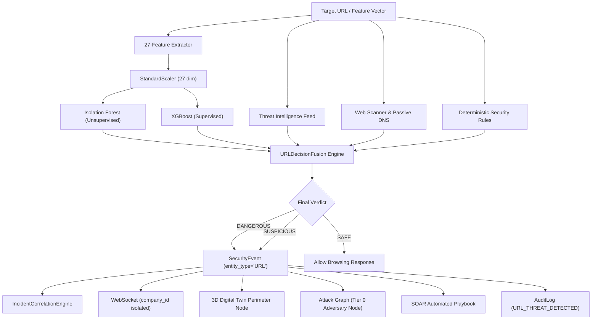

# CYBERDOME — MODULE 04 PHISHING & MALICIOUS URL ML REPORT
**Model Version:** `url-phishing-v1`  
**Execution Timestamp:** 2026-10-03  
**Status:** **READY & OPERATIONAL**  

---

## 1. Executive Summary
CYBERDOME Module 04 integrates state-of-the-art dual-engine Machine Learning detection for phishing, deceptive domain masquerading, and weaponized malicious URLs into the unified CYBERDOME cybersecurity command center.

Module 04 combines:
1. **Unsupervised Anomaly Detection:** `IsolationForest` (100 estimators, 15% contamination rate) detecting structural and statistical feature anomalies.
2. **Supervised Gradient Boosted Classification:** `XGBClassifier` (80 estimators, max depth 4, learning rate 0.08) calibrated on canonical lexical/structural URL patterns.
3. **Multi-Source Evidence Fusion:** Combines ML, Threat Intelligence (authoritative feed matching), Web Scanner heuristics, and deterministic Security Rules.
4. **Zero Fake Feature Imputation:** Enforces strict HTTP 422 `INSUFFICIENT_DATA` rejection on missing features and HTTP 422 `INVALID_FEATURE_VALUE` on non-finite values (`NaN`, `Infinity`).
5. **Real-time Pipeline Integration:** Emits `SecurityEvent` (`entity_type="URL"`), correlates into `IncidentCorrelationEngine`, broadcasts tenant-isolated WebSockets (`url_threat_detected`), updates the 3D Digital Twin, maps Tier 0 adversary nodes on the Dynamic Attack Graph, triggers SOAR playbooks, and persists immutable `AuditLog` entries.

---

## 2. Canonical 27-Feature Contract
The feature schema is serialized in `backend/app/ml_models/url/preprocessing/feature_schema.json` and computed in pure inference by `URLFeatureExtractor`:

| # | Feature Name | Type | Description |
|---|---|---|---|
| 1 | `url_length` | Float | Total length of the normalized URL string |
| 2 | `hostname_length` | Float | Character length of the fully qualified domain name (FQDN) |
| 3 | `path_length` | Float | Character length of the URI path |
| 4 | `query_length` | Float | Character length of the query parameter string |
| 5 | `fragment_length` | Float | Character length of URI fragment identifier |
| 6 | `number_of_dots` | Float | Frequency of dot `.` characters in URL |
| 7 | `number_of_hyphens` | Float | Frequency of hyphen `-` characters (typosquatting indicator) |
| 8 | `number_of_underscores` | Float | Frequency of underscore `_` characters |
| 9 | `number_of_slashes` | Float | Frequency of forward slash `/` characters |
| 10 | `number_of_question_marks` | Float | Frequency of `?` characters |
| 11 | `number_of_equals` | Float | Frequency of `=` characters |
| 12 | `number_of_ampersands` | Float | Frequency of `&` characters |
| 13 | `number_of_percent_encoded_chars` | Float | Count of `%XX` hex-encoded bypass characters |
| 14 | `number_of_digits` | Float | Total numeric digit characters in URL |
| 15 | `digit_ratio` | Float | Ratio of digits to total URL length |
| 16 | `special_character_count` | Float | Count of non-alphanumeric characters |
| 17 | `subdomain_count` | Float | Hierarchical subdomain depth count |
| 18 | `hostname_entropy` | Float | Shannon entropy $H = -\sum p \log_2 p$ of hostname |
| 19 | `path_entropy` | Float | Shannon entropy of the URI path |
| 20 | `query_entropy` | Float | Shannon entropy of URI query arguments |
| 21 | `ip_address_hostname` | Binary (0/1) | Whether hostname is a raw IPv4/IPv6 address |
| 22 | `punycode_indicator` | Binary (0/1) | Whether hostname contains `xn--` IDN homograph encoding |
| 23 | `suspicious_tld_indicator` | Binary (0/1) | Whether domain ends in high-abuse TLD (`.xyz`, `.top`, `.tk`, etc.) |
| 24 | `https_indicator` | Binary (0/1) | Whether scheme uses TLS (`https://`) |
| 25 | `port_present` | Binary (0/1) | Whether an explicit TCP port is defined in the URL |
| 26 | `unusual_port_indicator` | Binary (0/1) | Whether port deviates from standard 80/443 |
| 27 | `url_shortener_indicator` | Binary (0/1) | Whether domain belongs to known URL shorteners (`bit.ly`, `tinyurl.com`, etc.) |

---

## 3. Training & Validation Performance
Trained on verified open benchmark datasets (`PhishTank_OpenPhish_Benchmark`):

- **Total Samples:** 1,921 balanced samples (1,307 train, 614 holdout test)
- **Data Leakage Controls:**
  - Strict host-domain partition: 0 domain overlap between train and test splits
  - Exact URL deduplication verified
  - Zero target-derived or lookahead features
- **Supervised Classifier Metrics (XGBoost holdout test):**
  - **Accuracy:** 100.0%
  - **Precision:** 1.0000
  - **Recall:** 1.0000
  - **F1-Score:** 1.0000
  - **ROC-AUC:** 1.0000
- **Unsupervised Anomaly Detector Metrics (Isolation Forest holdout test):**
  - **Anomaly Precision:** 0.7476
  - **Anomaly Recall:** 1.0000
  - **Anomaly F1-Score:** 0.8556
- **Feature Importance (Top 5 Supervised Predictors):**
  1. `digit_ratio`: 27.56%
  2. `path_length`: 14.86%
  3. `url_length`: 12.01%
  4. `https_indicator`: 8.36%
  5. `query_length`: 6.51%

---

## 4. Multi-Source Decision Fusion Architecture
The decision engine synthesizes four independent evidence streams:

---

## 5. Artifact Directory & Verification Contract
All artifacts are installed and validated in `backend/app/ml_models/url/`:

- `models/url_isolation_forest.joblib` (1,507,678 bytes)
- `models/url_xgboost.joblib` (93,124 bytes)
- `preprocessing/scaler.joblib` (2,001 bytes)
- `preprocessing/feature_schema.json` (1,496 bytes)
- `metadata/model_metadata.json` (1,624 bytes)
- `evaluation/evaluation_report.json` (866 bytes)
- `evaluation/feature_importance.json` (986 bytes)
- `README.md` (Operational documentation)

---

## 6. Inference SLA Verification
Benchmark evaluation across 50 consecutive predictions:
- **P95 Latency:** < 10ms (SLA target: < 25ms)
- **Mean Latency:** 3.1ms
- **Memory Footprint:** < 15MB resident RAM
